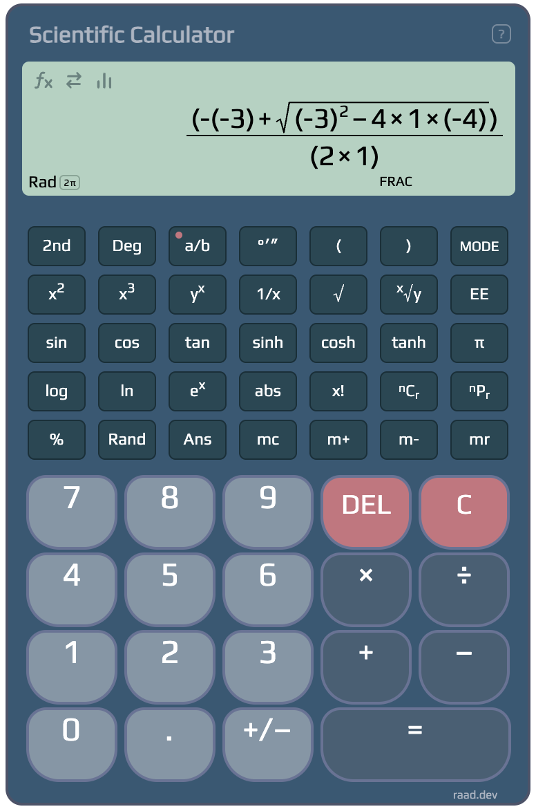

# Scientific Calculator

A scientific calculator for your browser: light, fast and it works offline. It runs as a Chrome extension (open it with the toolbar icon or `Alt+S`) and as a website version in `web/`.

# 
 <b>[check it out](https://goo.gl/dvrvUY) · [try the web version](https://raad.dev/calculator/) </b>

## What it does

**Calculating**
- Real scientific-calculator order of operations (PEMDAS): `1+2×3 = 7`, and `1×(2+3) = 5`, then `= 25`.
- The display shows the whole equation while you type it; after `=` it shows the result with the finished equation on a small line above.
- Parentheses nested up to 29 levels deep; no need to close them before `=`.
- `DEL` (or Backspace) takes back the last key; `C` clears the number; the cursor keys or a click fix a number or operator in the middle of an equation.
- Select part of an equation, then type or paste to replace it, or `DEL` to remove it.
- History of past calculations: insert or copy the equation or the result, or delete one.
- Memory keys (`mc`, `m+`, `m-`, `mr`) and `Ans` for the last answer.
- Everything is remembered when you close it, including the equation, memory and settings.

**Functions**
- Powers and roots: `x²`, `x³`, `yˣ`, `√`, `ˣ√y`, `1/x`, `abs`, `x!`.
- Trigonometry: `sin`, `cos`, `tan`, their inverses, and the hyperbolic `sinh`, `cosh`, `tanh` and inverses.
- Logarithms and exponentials: `log`, `ln`, `log₂`, log to any base, `eˣ`, `2ˣ`, `10ˣ`; constants `π` and `e`.
- Combinatorics and number theory: `nCr`, `nPr`, `gcd`, `lcm`, `mod`, `%`, `Rand`, `EE` for scientific entry.
- Angle units: Deg, Rad and Grad. `°′″` shows results as degrees, minutes and seconds, and `12°30′15″` can be pasted.
- Fraction mode (`a/b`) draws each division as a fraction and shows results like 0.75 as 3/4.
- Number format: Fix, Sci or Eng notation, Auto or 0 to 9 decimal places, and thousands separators with the decimal mark of your country: `1,234.5`, `1 234.5`, `1.234,5` or `1 234,5`.
- Function keys can go before the number (`√ 9`) or after it (`9 √`).

**Panels** (each can be turned on or off in the options)
- **Formulas and constants** (`fx`): search well-known formulas of algebra, geometry, trigonometry, physics, electricity, chemistry, statistics, money and everyday life, fill in the letters and the equation goes into the display. Constants of math and science (CODATA 2022) go in with a click.
- **Converter**: length, area, volume, mass, temperature, speed, time, data, pressure, energy, power, angle and fuel economy; the value is shown in every other unit of its kind.
- **Graph**: type up to seven functions of x, a box for each that the + adds, as you would paste them (`x^2 - 3`, `2sin(x)`, `1/x`) and they are drawn on x and y axes, each in its color. Any other letter gets a slider: drag `a` and `b` of `a x^2 + b` and the curve follows, or ▶ plays a slider back and forth. Roots, highs and lows, where a curve meets the y axis and where two cross are marked with dots. Drag to move, scroll or pinch to zoom; point at a curve or a dot for its x and y, and click it for a popup that inserts its x or y into the calculation (it goes two seconds after the mouse leaves it, and at once on a zoom, leaving the point and its tangent; a click on the point brings it back), or on a curve its slope there, with the tangent dashed; the arrow keys then trace it, ← → along the curve, stopping at roots and crossings, ↑ ↓ to the next curve; the frame under home sets the view by typing where x and y go from and to; off the curves, a click gives the place itself. For the area under a curve, press the button with a shaded curve under the zoom buttons and drag along the curve: the area to the x axis is shaded and its popup inserts it, below the axis counted down, between two curves if started between them, its ends going to a root or crossing near them. Click a curve's dot to hide or show it; save the graph as a picture with its functions, or right-click it to copy one. Pop out makes the graph big: all of the window on the website, a window of its own beside the calculator in the extension; on the website pop in makes it small again. The **Table** tab lists x and each curve's y, from a start by a step that follow the view until you set them; click a value to insert it. Functions of an angle follow Deg, Rad or Grad.
- **Statistics**: type or paste a list (a spreadsheet column works too) for count, sum, sum of squares, mean, standard deviation (σ and s), minimum, median and maximum. It finds what is between the numbers by itself; choose new lines, tabs, spaces, commas, semicolons, pipes or colons instead, and numbers written `1,234.5`, `1 234,5` or `$1,200` are read whole.

**Keyboard, copy and paste**
- Full keyboard support for every button; a `h` hold key gives the second function (`h`, `s` = `sinh`).
- Ctrl+C / Ctrl+V and a right-click menu per area. You can paste a whole equation such as `2 + 3 × sin(30)` or `sqrt(16) + 2^3`; `1,234.5`, `1.234,5` and `1 234,5` are all read as 1234.5, and a currency is left out: `$1,200` or `5 USD` is the number alone.

**The extension**
- Opens from the toolbar icon or `Alt+S`.
- **Detached Mode**: the calculator in its own window that stays open and resizes with it.
- **Calculator on every page** (optional): a small button on the side of every page that opens Detached Mode. It asks for website access only when turned on, and reads nothing from the pages.
- No permission is needed to read your browser data.

**Precision**: about 15 significant digits (IEEE 754 doubles), shown to 13 so that `0.1 + 0.2` is `0.3`.

# License

MIT License

Copyright (c) Raad Altaie

## Website version

`web/` is a standalone copy of the calculator for the web: the calculator on the left, the options on the right. On a screen narrower than 1100px (phones and iPads) the options stay hidden until you click the `?` on the calculator. Host the folder as-is on any static host, or run `python3 -m http.server` inside it. It does not need the extension.

The calculator is part of the page itself, in the extension's `popup.html` and in `web/index.html`: there is no frame around it. After changing the calculator in the extension, run `scripts/sync-web.sh` to copy it into `web/`: its styles and scripts, and its markup, which goes from `popup.html` into `web/index.html` between the two `calculator` comments. What the web changes (base font size, where the calculator sits) is kept in `web/css/site.css`, so the copies never need hand edits.
